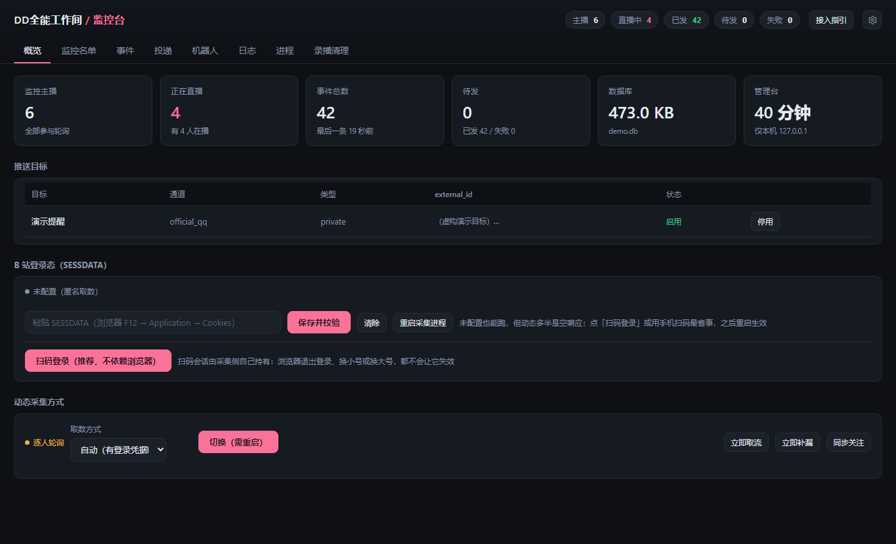
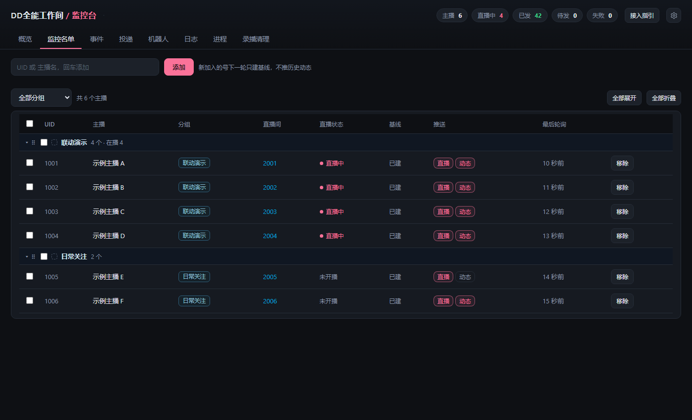
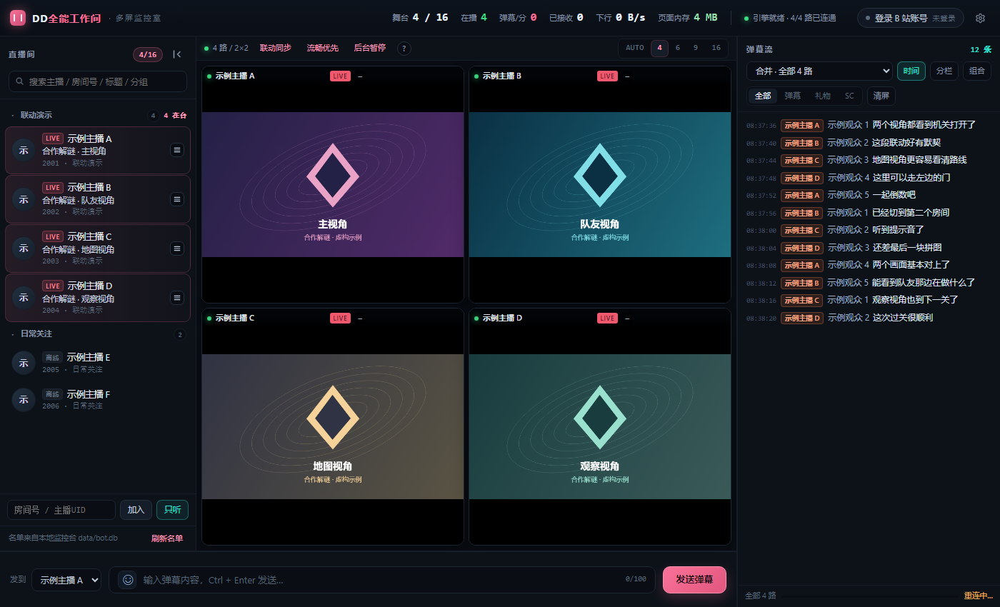

# B 站主播监控与直播工作台

把关注的主播动态和开播状态集中到一个本地工作台里。主播开播、下播或发布动态时，工具可以通过你自己的 QQ 官方机器人发送提醒；想看直播时，也能在多房间监控台里同时打开多个直播间。

适合希望及时跟进一批主播，或想同时看多个直播视角的 B 站用户。

[下载 Windows 发行包](https://github.com/VictorKiseki/bili-monitor/releases/latest)

> 本项目是与哔哩哔哩、腾讯无关的非官方工具。

## 一眼看懂

| 你想做的事 | 工具提供的功能 |
| --- | --- |
| 不错过主播开播和动态 | 持续关注名单中的主播，发现开播、下播和新动态后推送 QQ 提醒 |
| 看清提醒内容 | 将直播或动态整理成带标题、封面、摘要和链接的消息卡片 |
| 同时看多个直播间 | 在多屏直播监控台中排列房间、查看弹幕和直播状态 |
| 管理大量关注对象 | 按分组整理名单，单独控制直播和动态提醒 |
| 了解运行情况 | 在管理台查看当前状态、事件记录、任务和日志，并调整设置 |

## 功能亮点

### 主播动态与开播提醒

把想关注的主播加入名单后，工具会跟进其直播状态和新动态。直播提醒与动态提醒可以分别开关，也可以按主播单独设置。新添加的主播先建立当前状态基线，不会把加入之前的旧动态当作新消息推送。

QQ 通知由你自己的 QQ 官方机器人发送，可发给已绑定的个人或群目标。卡片消息附带内容摘要和原始链接，点开即可回到 B 站查看。

### 多屏直播监控台

把多个直播间放在一个页面里，按需切换房间、分组和弹幕视图。适合同时关注联动直播或在活动期间快速掌握多个房间的情况。直播台提供独立界面，可与管理台同时使用。

### 面向日常使用的管理工具

- **分组管理**：给主播分类、调整顺序，并批量启用、停用或移动名单。
- **提醒开关**：按主播分别控制直播和动态提醒。
- **录播空间管理**：可选启用录播目录检查；发现超限文件时先通知并留出确认时间。
- **本机数据**：运行数据保存在自己的电脑上，提供本地 Web 管理台，不需要注册本项目的云端账号。

## 效果展示

以下截图使用虚构的主播、房间、弹幕和直播画面。

### 管理台：查看监控概况与主播名单

### 多屏直播台：同时查看多个房间

## 使用方式

### 1. 安装并打开管理台

适用 Windows 10（1809 及以上）或 Windows 11，64 位。普通用户使用发布包时**不需要另外安装 Python**。

1. 从项目的 [GitHub Releases](https://github.com/VictorKiseki/bili-monitor/releases) 下载最新发布包并解压。
2. 双击解压目录中的 `install.cmd`。
3. 安装完成后，管理台会在浏览器打开：<http://127.0.0.1:8765>。

首次安装指引也可参阅[发布与交接手册](docs/31-发布与交接手册.md)。

### 2. 接入自己的 B 站账号和 QQ 机器人

在管理台打开「接入指引」，按页面提示扫码登录 B 站，并填写你自己的 QQ 官方机器人信息、绑定消息接收目标。之后在「监控名单」里添加希望关注的主播。接入完成后，采集和通知任务会按绑定状态自动启动。

### 3. 打开多屏直播台

需要同时看多个房间时，打开「监控室」或访问 <http://127.0.0.1:8760>。其他功能和详细设置见[用户指南索引](docs/37-文档与代码索引.md)。

## 常见问题

**一定要绑定 B 站账号吗？**  可以匿名运行部分监控功能；使用自己的 B 站登录态通常能让动态采集更稳定。可在管理台通过扫码方式接入。

**一定要配置 QQ 机器人吗？**  不配置时仍可使用管理台查看本机的监控信息，但不会向 QQ 发送通知。QQ 机器人需要由用户自行创建和绑定。

**数据会上传到哪里？**  本项目不提供云端账号或托管服务；监控数据和设置保存在运行本程序的电脑上。使用外部服务时，相关数据会发送给你配置的服务。

**直播视频和弹幕也走本地代理吗？**  管理台中的代理仅用于本程序发出的 HTTP(S) 请求；浏览器播放直播、弹幕连接和 QQ 收消息连接由各自客户端直接建立。

## 项目信息

- **当前版本**：见 [`VERSION`](VERSION)；功能变化记录见 [`CHANGELOG.md`](CHANGELOG.md)。
- **许可**：[MIT License](LICENSE)。
- **反馈与问题**：[GitHub Issues](https://github.com/VictorKiseki/bili-monitor/issues)。
- **完整用户文档**：[文档索引](docs/37-文档与代码索引.md)。
