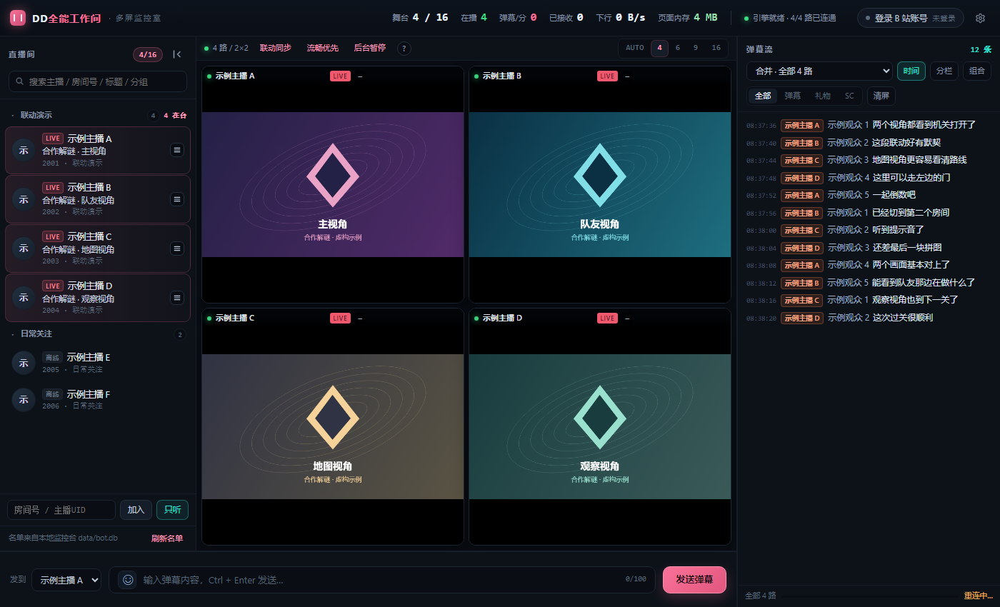

# 多屏直播监控台（DD全能工作间 · 监控室）

> 命名：「监控室」是「DD全能工作间」里的多屏直播台界面，另一半是 Web 管理台「监控台」（[docs/12](12-Web管理台.md)）。产品名、页脚版权与顶栏品牌统一为 DD全能工作间 / © 2026 VictorKiseki。

在一个本地网页里同时看 4~16 个 B 站直播间，右侧把各房弹幕合并成一条流，可以按房间筛选、按类型过滤，也能直接往某个房间发弹幕。启动后是一个独立 Web 应用（`http://127.0.0.1:8760/`），不需要动现有的采集主循环。



> 上图是 16 路实测截图：4×4 排布、16/16 路弹幕桥连通、顶栏「弹幕/分 1217 · 已接收 1217」，每格都在出画。

## 1. 怎么启动

```bash
python run_livedeck.py                # 默认 http://127.0.0.1:8760/ ，自动开浏览器
python run_livedeck.py --port 8800    # 换端口
python run_livedeck.py --no-open      # 不自动开浏览器
```

依赖只用到环境里已有的 `httpx`、`websocket-client`、`websockets`，外加系统自带的 Microsoft Edge（弹幕桥借用它的浏览器环境）。`brotli` 是**可选**依赖（`requirements-optional.txt`）：装了就用 `protover=3` 的 brotli 压缩帧，没装就自动退回 `protover=2` 的 zlib（标准库），两种都能收全弹幕。播放器 `mpegts.js` 和 `hls.js` 内置于 `livedeck/static/vendor/`，随页面从本机加载。

> 必须在**你自己的终端窗口**里启动。从 DSH 的后台 job 里启动时，Edge 子进程会被 Windows 作业对象限制住、起不来 DevTools 端口（见第 8 节）。

## 2. 界面

三栏布局：

| 区块 | 内容 |
|---|---|
| 左栏 | 名单直接读 `data/bot.db` 的 `subject` 表（uid / 头像 / 昵称 / 分组 / 直播状态；行内不显示每房弹幕条数），按监控台分组折叠展示，勾选即上屏；每行右侧只有一个三横线图标按钮，点开二次菜单（全部用文字）：加入舞台 / 移出舞台、只听弹幕（不上台，见 4.1）/ 停止只听弹幕、设置分组（仅名单内房间）、加入监控台名单（仅临时房间）、移除直播间（临时房间可「从列表删除」；名单内房间可隐藏 / 停用 / 删除）、设置印象色（给该房间指定弹幕标签的主 / 辅色相种子，见 §4.7）。另有搜索框、底部输入框（房间号 / 主播 UID / 直播间链接都能填，自动识别，见 §4.10）加入舞台或「只听」，临时房间不进监控名单。临时房间移出舞台后**仍留在列表里**（存于 data/livedeck_state.json 的 temp 字段，重启也在），只有点操作菜单 →「从列表删除」才会消失 |
| 中间舞台 | AUTO / 2×2 / 3×2 / 3×3 / 4×4 五种排布，最多 16 路。每格优先播放本地中继的 HTTP-FLV。当房间仅提供 HLS 时，自动切到 HLS 播放（见第 5 节）。两种画面都能统一静音。格子头部有直播状态徽标、该房当前房间观众数（弹幕流 ONLINE_RANK_COUNT.online_count，与 B 站房间页右侧「房间观众(N)」同源；过万缩写「1.2万」，未开播显示「—」；旁边还有一个「舰 N」小徽标，是大航海（舰长 + 提督 + 总督）总人数，来自 HTTP 的 `getInfoByRoom.guard_info.count`，见 §4.6，0 人或未开播时整块隐藏）；按钮 `▣` 重点观察（把这一路放大到 2×2 / 3×3，见下一段）、`⤢` 单路放大、`🔇` 声音、`↗` 用浏览器打开原页面、`↻` 重连画面、`×` 移出舞台，双击格子也能单路放大。**按住格子标题栏拖动**可以调整这一路在舞台上的位置（顺序即排布，POST `/api/active` 存服务端、重启保持）；房间名显示全名，格子窄时用省略号、悬浮看完整名字。格子自身不挂 `title`（鼠标扫过画面不会弹出内部状态），弹幕通道状态看左上角圆点的悬浮提示（「弹幕通道：已认证」这种中文） |
| 左栏分组顺序 | 分组头可以直接**拖动排序**（按住分组名上下拖，目标位置出现粉色插入线），松手即保存；「临时」组固定排最后，顺序见 §4.8。搜索过滤时拖动只影响被拖的那一组，其余保持原位置 |

| 右栏弹幕流 | 顶部选择「合并 · 全部」、舞台上的某个房间，或「只听弹幕」分组里的房间（合并计数包含舞台与只听弹幕）；分段按钮 全部 / 弹幕 / 礼物 / SC / 清屏。合并模式下每行带房间色标（设了印象色的房间按 §4.7 的种子取色，否则按房间号哈希），弹幕、上舰（整行按 舰长 / 提督 / 总督 染色，行首是 B 站大航海图标）、SC、进场都会进来，底部有每分钟速率条（最近 60 秒收到的弹幕条数，和顶栏「弹幕/分」同一个数，30 条/分算满格）。弹幕里的表情包直接渲染成图片（22px 高，见 4.2） |
| 底栏 | 目标房间下拉（只列舞台房间，只听弹幕的房间不可发送）+ 输入框（Ctrl+Enter 发送，100 字上限）+ 右侧 ☺ 表情按钮，发送后本地立刻回显一条「自己」的弹幕 |

左栏在主播昵称下显示已获取的直播标题，过长时单行省略，悬停可查看全文，也可按标题搜索。采集进程运行时，未加入舞台的在播房间可直接使用监控台保存的场次标题。

左栏房间操作菜单在自动刷新期间保持打开，并随当前房间的按钮重新定位。房间移除、被搜索过滤或所在分组折叠时，菜单会关闭。

顶栏显示：舞台路数、在播数、弹幕/分、已接收条数、下行流量（悬停看每路速率）、页面内存（超过 1.2 GB 变橙，点一下重建全部播放器）、引擎连通状态（已连通路数/总数）、登录芯片（昵称 + 是否可发弹幕，点开是登录弹窗）。

顶栏最右侧是一个**齿轮设置按钮**（`#settings-btn`，取代了原来单独的 `?` 帮助按钮），点击打开菜单，点空白处或按 Esc 关闭：

| 菜单项 | 行为 |
|---|---|
| 监控台 | 新标签页打开 Web 管理台 `http://127.0.0.1:8765/`（管理台得先跑着，打不开就是它没启动） |
| 联动同步测试 | 新标签页打开独立的同步测试。可输入 2–3 个房间号，或复制舞台的前三路 |
| 使用说明 | 打开使用说明弹窗（`#help-mask`），即原来顶栏 `?` 打开的那一份内容 |
| 网络代理 | 打开「网络代理」弹窗（`#proxy-mask`），右侧小字跟着模式显示「跟随系统 / 不使用 / 自定义」 |
| 更新检查 | 打开「更新检查」弹窗（`#upd-mask`），标「与 Gitee 比对」 |
| 关于 | 打开「关于」弹窗（`#about-mask`），标「版本信息」 |

**联动同步测试**（`/sync-lab.html`）点「开始测试」后单独拉流，输入和延迟只保留在当前页面。先等待各路积累约 3 秒缓存，再以共同的播放时钟推进画面。开始时试听第一个房间，初始总音量为 50%。「播放声音」可同时勾选多个房间，取消全部勾选即可静音。多路声音平分总音量以降低削波风险。自动校准在浏览器内匹配各路原始音频，连续两段偏移吻合后才更新，声音不足或不确定时沿用当前延迟。手动修改任一路额外延迟会切到手动模式，也可重新勾选自动校准。支持 0–8 秒额外延迟，开播失败或直播流中断时可停止后重试。

初次自动校准可应用最多 8 秒的额外延迟，与手动可填写的范围一致。较大的时差需要先积累更多音频。确认后只在该组相对偏移附近跟踪，任何两路相对补偿偏离超过 0.5 秒时会保留当前值。手动填写的偏移可以作为跟踪基准，点「延迟归零」可清除基准并重新估算。

停止或关闭测试标签页即可释放拉流。测试与舞台使用独立播放器和 HTTP 拉流入口，并共用浏览器内的音频校准。若需撤下测试入口，可移除设置菜单里的测试链接、`livedeck/server.py` 中的 `/api/sync-lab/flv` 分支、`livedeck/sync_lab.py`、`livedeck/static/sync-lab.html` 和 `livedeck/static/sync-lab/app.js`。

### 舞台联动同步

先把要观看的直播间放上舞台，再点舞台顶部「联动同步」，手动勾选 2–9 个当前显示的房间，然后点「开启同步」。选中的画面会显示「联动」，悬停可看每路额外延迟。每个画面继续使用自己的画质和音量，可以同时打开多路声音。

默认按共同音频自动校准，沿用测试页的自动补偿范围和跟踪约束。重新打开对话框可换房、重新校准或停止同步。关闭「按共同声音自动校准」可填写各房间的 0–8 秒额外延迟。所选房间暂时被单路视图或排布隐藏时会等待它恢复上屏，移出舞台时结束该组同步。选房和补偿只保留在当前页面，刷新后可重新选择。

四路以上以所选的第一路为时间参考。其它房间可以直接匹配参考房间，也能通过有共同声音的房间间接对齐。每条用于校准的偏移需由两段独立音频确认，额外配对用于核对相对偏移。九路直连时每轮比较 10 对，需要中转时每轮至多比较 16 对。短暂卡住或跳转的音轨会从当前窗口剔除，已有的可靠关系可短暂复用。连接不全或估算冲突时保留当前延迟。

**「网络代理」弹窗**（`#proxy-mask` / `.proxy-modal`，470px）与监控台那份是同一套字段、同一份配置文件：

- 模式三选一：不使用代理（`#proxy-mode-none`）/ 使用系统代理（`#proxy-mode-system`，默认）/ 自定义代理（`#proxy-mode-custom`）；只有自定义时代码框可编辑。
  - 「不使用代理」= 主动删掉 `HTTP_PROXY` / `HTTPS_PROXY` / `ALL_PROXY`（含小写），系统里设了也不走；
  - 「使用系统代理」= 完全不动这些变量，沿用系统 / 启动脚本里的代理；
  - 「自定义代理」= 地址 `#proxy-url`（形如 `http://127.0.0.1:7890`）写进代理变量。
  地址只接受 `http://` / `https://`，`socks5://` 会被拒绝（httpx 走 socks5 要额外的 socksio 依赖，本项目不装）。切换模式不会清掉已填的地址。
- 三个按钮：测试连接（`#proxy-test`，服务端用这个代理访问一次更新检查地址）、保存（`#proxy-save`）、取消（`#proxy-cancel`）；状态行 `#proxy-status` 写读配置 / 已保存 / 连接成功（HTTP 200，xx ms）/ 失败原因。
- 配置存项目根目录的 `config/proxy.json`（`mode` / `url` / `no_proxy`），和监控台改的是同一个文件；真实文件在 `.gitignore` 里，模板是 `config/proxy.json.example`。旧版只有 `enabled` / `url` 的配置仍能读（开着且有地址按自定义，其余按系统代理）。
- 保存后 `shared/proxy.py` 按模式改进程环境变量（自定义写入、不使用删掉、系统代理还原），所有 httpx / urllib / websocket-client 出口默认 `trust_env`，**本进程新的请求立即生效**。
- **在跑着的进程也会自己跟上（2026-11-20）**：本页保存后立刻调 `Deck.apply_proxy()` 重建三个连接池（`stream_http` / `http` / `BiliClient`），页面和舞台都不用刷新；另有 `deck-proxy` 线程每 5 秒比对 `config/proxy.json` 的指纹，在监控台（8765）那边改的也能跟上。采集 / 推送由监控台的 `StackManager` 盯同一个指纹自动重启，几秒内生效。以前这两件事都要手动重启，代理软件崩了没起来时会一直报 `[WinError 10061]`。
- **不覆盖**浏览器里的画面与弹幕（走本机 Edge 的 CDP 桥）和 QQ 收消息的 `websockets`（库不支持 HTTP 代理）；`no_proxy` 默认 `127.0.0.1,localhost,::1`，本机服务不走代理。

| 接口 | 返回 |
| --- | --- |
| `GET /api/proxy` | 当前配置 `{ok, mode, mode_name, enabled, url, no_proxy, active}`（`enabled` 仅为兼容旧前端，只有自定义且填了地址才 true） |
| `POST /api/proxy` | body `{mode, url}`；模式非法 / 自定义却没地址都 400；成功附 `note`（监控室立刻换连接，采集 / 推送几秒内自动重启） |
| `POST /api/proxy/test` | body `{mode, url}`（缺省用已保存的）；`none` 直接回「不用测试」，`system` 按系统代理测；`{ok, passed, status, ms, target, error}` |

**「关于」弹窗**（`#about-mask` / `.about-modal`）与监控台那份用同一套文案，只按本页主题落地样式：标题「DD全能工作间」+「版本 vX.Y.Z · MIT 许可」、一句话说明、三条要点（数据只在本机 / 只监听环回 / 非官方工具）、开发者三行（邮箱是**纯文本不可点**可选中复制；源码与反馈是 Gitee 仓库与 `/issues` 的链接，新标签页打开）、页脚写平台与许可。关闭走右上角 ×、点遮罩空白处、Esc 三处。

**「更新检查」弹窗**（`#upd-mask` / `.upd-modal`，430px）只读仓库里的 `VERSION` 和本机比一下，不下载、不升级：打开时先「正在检查…」，向 `GET /api/update` 要结果（服务端 `shared.update.check()` 按 `opensource` → `master` → `main` 的顺序试 `raw/<分支>/VERSION`，6 秒超时；`opensource` 是发布线，排第一是为了跟已发布版本比），回三种状态——发现新版本（「发现新版本 vX.Y.Z，可到仓库看更新说明」）、已是最新、检查失败（「检查失败：HTTP 403」，当前版本仍显示）。关闭走右上角 ×、「关闭」按钮、点遮罩空白处、Esc 四处，Esc 链顺序是 清理弹窗 → 进度 → 关于 → 更新检查 → 设置菜单。

- 仓库已公开；`/raw/<分支>/VERSION` 会 302 到 `raw.giteeusercontent.com`，服务端跟随重定向。分支名不对或仓库里没有 `VERSION` 时显示「检查失败：仓库里没有 VERSION（HTTP 404，试过 opensource / master / main）」，方便判断是分支改名还是文件丢了。

- **版本号不写死**（AGENTS §1 R5）：页面上只有占位「—」，打开时向 `GET /api/version` 取一次再填，服务端读的是 `shared.version.read_version()`，唯一来源仍是仓库根目录的 `VERSION`。
- 文案改动要两侧一起改（`livedeck/static/index.html` 与 `web/index.html`），`tests/test_about_dialog.py` 会同时断言两边，只改一边会红。

舞台头右侧还有两个开关：**「流畅优先 / 低延迟」**（播放模式，见 8 节第 5 条）和 **「后台暂停 / 后台续播」**（窗口最小化后要不要继续播，见 5.2）。

这两个开关右边的 **`?`** 会弹出它们各自的说明（播放模式、后台播放的取舍），点空白处或按 Esc 关闭。

排布是**严格形状**的：选 2×2 就只有 2×2，房间多了不会偷偷变 2×5，多出来的那几路会提示「还有 N 路未上屏（仍在收弹幕）」，点 AUTO 或换更大排布就全露出来。预设存进 `data/livedeck_state.json`，重启恢复。

### 2.1 重点观察：把其中一路放大成 2×2 / 3×3

多分格布局下想看某一路的细节，点该格标题栏的 **`▣`** 即可循环切换 **2×2 → 3×3 → 还原**（选 3×3 需要 3×3 或 4×4 排布；2×2 排布本身已经是四格，放大会只剩这一路）。放大的格子用 CSS `grid-column / grid-row: span N` 跨格，其余房间按原顺序补进剩下的格子（`grid-auto-flow: row dense`），装不下的提示「还有 N 路未上屏」——它们仍在收弹幕，切回小格就重新出画。舞台标题会显示「重点观察 1 格 2×2」。

- 放大只影响**本机观感**，而且只记在当前页面：房间每次重新进舞台都从 `1×1` 开始，刷新页面也全部还原；不再写 `localStorage['ld.zoom']`，不会写进 `data/livedeck_state.json`，也不影响别的浏览器窗口。
- 与单路视图（`⤢` / 双击）的区别：单路视图会停掉其它播放器（省 CPU/内存）；重点观察只是把这一格放大，其它路照常解码。
- 拖动换位、画质/音量、弹幕合并都照常可用。

## 3. 登录

- 顶栏登录芯片 → 扫码登录：复用 `collector/bili_login` 的二维码流程，走的是独立设备会话，不影响采集进程那份凭据。打开弹窗会立刻申请二维码，失效可「换一张」。
- 兜底「粘贴 Cookie」：SESSDATA + bili_jct + DedeUserID 三项。**发弹幕必须要 bili_jct**，只粘 SESSDATA 只能看不能发。
- 凭据优先级：`config/livedeck.env`（本工具扫码/粘贴后写入）→ `config/bili_follow.env` → `config/bili.env`。所以只要 follow 那份有效，打开就能直接发弹幕。
- 登录态同时用于「发弹幕」的 HTTP 链路（`/msg/send` + Cookie）和「收弹幕」的 token 申请：`getDanmuInfo` 带登录 Cookie 取到的 token 必须配登录 uid 认证。没登录也能看画面、收弹幕，但 B 站会把发送者昵称脱敏成「礼***」（见下一节）。
- 登录态校验有四种状态（2026-11-20）：`ok`（芯片「可发弹幕」）、`expired`（B 站明确回 `isLogin=false`，芯片「登录已失效」，要重新扫码）、`network` / `risk`（连不上 B 站，或被风控以 HTTP 412 拦下，芯片「登录态未校验 · 稍后重试」，**Cookie 往往还是好的**，15 秒后自动重试，`can_send` 仍为 true 允许尝试发送）。启动时会先按 `config/proxy.json` 调一次 `apply_to_env()` 再建连接池，校验遇到连接错误会重建一次连接池再试——进程从带旧代理的父进程继承环境时（代理软件已经退出），这一步是必需的。

## 4. 弹幕是怎么接进来的（关键设计）

B 站 2026 年的弹幕 WebSocket 会按 TLS 指纹（JA3）拦截非浏览器客户端：认证包字段全部照抄真实页面（含新增的 `support_ack / queue_uuid / scene:"room"`）也照样在 `op=8` 之前被 1006 掐断。所以不能用 Python 直连。

实际做法是**本机 Edge + DevTools 协议桥**：

1. `livedeck/bridge.py` 用 `--headless=new --incognito --mute-audio` 起一个独立的 Edge（每次 `tempfile.mkdtemp()` 新建 profile，端口随机，不复用 user-data-dir），打开 `https://live.bilibili.com/robots.txt` 让页面 Origin 天然是 `live.bilibili.com`；
2. 通过 CDP `Network.setCookie` 把 SESSDATA / bili_jct / DedeUserID / buvid3 写进去，`Runtime.addBinding('ldSend')` 建立回传通道；
3. token 由 **Python 侧**取：`app.danmu_token(room)` 用 WBI 预签 `getDanmuInfo`（`_sign({"id":room,"type":0})`，token 有效期约 8 分钟，`TOKEN_TTL=480` 到点重签），**请求头要带登录 Cookie（SESSDATA / bili_jct / DedeUserID / buvid3）**，拿到 `token + host + wss_port` 后随房间列表下发给页面；页面只负责 `new WebSocket(wss://{host}:{wss_port}/sub)`，发完整认证包，每 20s 发 `op=2` 心跳（漏心跳就收不到推送）。**不要改回页面 fetch**：同一个已签名地址在 headless 页面里请求会被风控返回 `-352`，Python 侧则稳定 `code 0`；
4. 收到的二进制帧 base64 后经 binding 回传 Python，`livedeck/hub.py` 解 16 字节头（`>IHHII`），`protover=2` 走 zlib、`3` 走 brotli，按 `\x00` 分片解析 JSON；认证包里的 `protover` 不再写死，由 `hub.protover_for_server()` 按本机有没有 brotli 决定（没有就报 2），解压时再按另一种压缩兜底一次；`/api/diag` 的 `decode`（`brotli` / `protover` / `dropped`）就是给这一步看病的；
5. 断线 3s 起指数退避重连（上限 30s），房间增减时用 `__ldSetRooms()` 增量下发，不用重启浏览器。

服务端签名这一步不能省：`getDanmuInfo` 无签名稳定返回 `-352`。

**token 和认证 uid 必须配对。** 2026-11 实测的三种组合：

| 取 token 时 | 认证包 uid | 结果 |
| --- | --- | --- |
| 匿名（无 Cookie） | `0` | 能连上，但 80% 以上弹幕的发送者昵称被抹成「礼***」、uid=0 |
| 匿名 | 登录 uid（`示例 UID`） | `1006` 秒断 |
| 带登录 Cookie | 登录 uid | `{"code":0}` 认证通过，昵称、uid、粉丝牌都完整 |

所以现在`_bridge_items()` 在登录态下把 `uid` 填成登录 uid，`danmu_token()` 取 token 时带同一份 Cookie + buvid3（buvid 必须和认证包里的一致）；登录/退出会清空 token 缓存（`_on_creds_changed` 里 `self._danmu.clear()`），避免拿旧 token 继续用。**没登录时的降级**：走「匿名 token + uid 0」，弹幕照收、画面照看，只是昵称会显示成「礼***」——这是 B 站服务端行为，不是显示层截断，登录后即恢复完整昵称。

### 4.1 弹幕流跟随舞台 + 只听弹幕（2026-11-08）

弹幕桥会把所有桥接房间的 `msg` 都推给 SSE，所以「只显示哪些房间」必须由服务端把关。舞台之外还可以「只听弹幕」：房间不进舞台、不拉 FLV、不占 16 路格子，但会加入弹幕桥的订阅列表，只在右栏弹幕流里出现。`LiveDeck.listening` 持久化在 `state["listening"]`，上限 `MAX_LISTEN=16`。

- `deck_rooms._watched_rooms()`：舞台在前、只听弹幕在后、去重；`_bridge_items()` / `_sync_bridge()` / `_reconcile()` 都用它，所以监听房也会取 token、连 WS、断线重连。
- `server.py` 的 `_stream`：`allowed = set(rooms) if rooms else set(deck._watched_rooms())`，不在 `allowed` 里的 `msg/status/online/room_live` 直接丢弃。
- `app.js` 的 `watching(id)`：舞台或只听弹幕任一命中才上屏；`setActive()` / `setListening()` 切换时同步过滤 `st.msgs` 并 `rebuildFeed()`。
- 房间上舞台会从 `listening` 自动移除；停止只听会 `hub.reset_room()` 清掉缓冲。`POST /api/listen {rooms:[...]}` 整表替换；`/api/flv` 仍只认 `deck.active`，监听房**不会**产生视频流量。
- `pass()` / `onMessage()` 用 `watching()` 再兜一层，防止快照期间的竞态消息混进来。

`/api/reload`（刷新名单）会保留所有**手填房间号**的临时房间（不只在舞台上的）：`load_rooms()` 重建 `self.rooms` 时把旧表里 `from_db=False` 的条目带过来，否则点一次刷新舞台/列表就被清空。

### 4.2 表情包（收 / 发）

**收**：`DANMU_MSG` 里表情弹幕的 `info[0][13]` 是个对象（`url / emoticon_unique / width / height / bulge_display / in_player_area / is_dynamic`），`info[1]` 是表情的中文名，`info[0][12]`（dm_type）= 1。`hub.py` 把它抽成 `extra.emoticon = {url, unique, width, height}`（url 统一换 https），前端 `msgNode` 见到就渲染成 ``（带 `referrerpolicy=no-referrer`，否则 B 站图床会因为本地 Referer 403）。

**发**：`POST /api/send {room, emoticon:"官方/房间的 emoticon_unique"}`，走同一个 `/msg/send`，但要额外带：

| 参数 | 值 |
| --- | --- |
| `msg` | `emoticon_unique`（例如 `official_331`、`room_25971921_77937`） |
| `dm_type` | `1` |
| `emoticonOptions[emoticonUnique / url / width / height / emoji / inPlayerArea / isDynamic / bulgeDisplay]` | 该表情在列表接口里的字段（bracket 形式扁平化提交，实测被接受） |
| `csrf` / `csrf_token` | `bili_jct` |

参数是从 B 站网页播放器 JS 里逆出来的（`blfe-live-room/static/js/9649.*.js` 的 `sendEmoticons`），不是猜的。

**表情列表**：`GET /api/emoticons?room=` → 服务端用登录 Cookie 拉 `xlive/web-ucenter/v2/emoticon/GetEmoticons?platform=pc&room_id={real}`（匿名直接 `-101 账号未登录`，所以未登录时面板提示「登录后才能读取表情包」）。返回按包分组：`pkg_type=1` 通用表情（`official_{id}`）、`pkg_type=2` UP主大表情 / 房间专属（`room_{room}_{id}`），每个表情带 `unique / name / url / width / height / perm / locked`。结果按房间缓存 10 分钟（`EMO_TTL=600`），登录/退出时清空。

面板里切 tab 不会收起面板：`renderEmo()` 会整块重写 `panel.innerHTML`，被点的 tab 节点在事件冒泡到 `document` 之前就已经脱离 DOM，外层「点空白处关闭」会把它误判成点了外面。所以 tab 与关闭按钮的 click 都要 `stopPropagation()`。

**房间与舰长限定**：接口会给出 `unlock_condition`（粉丝牌等级 / 舰长等），服务端把它归一到 `locked=true + lock_label`。这类表情在面板里灰掉、点了提示「需要粉丝牌 / 舰长权限」，服务端也会拒绝（403），不会白发一条空弹幕 —— 当前账号没有对应权限就发不出去，这是 B 站侧的权限，不在工具能绕过的范围。

两个坑记一下：注入必须等页面真的导航到 `live.bilibili.com` 之后（否则 `__ldSetRooms` 落在 `about:blank` 上，同步返回「成功但 0 个房间」）；被替换掉的旧 WebSocket 还会补发一次 `onclose`，不能让它覆盖新连接的状态，否则桥会一直显示 `closed`（但弹幕其实在涨）。

### 4.3 临时组合（合并几条流，快速切换）

「合并 · 全部」和「单个直播间」之间还缺一种：同时盯三四路、且只盯这几路。弹幕流上方下拉旁边有「组合」按钮：

- 勾选「在舞台」或「只听弹幕」里的 2~32 个房间 → 命名（可留空）→ 保存；至少 2 个房间，最多 20 组。
- 下拉里多出一个「临时组合」分组，列出每个组合的「可收路数/总路数」（舞台与只听弹幕都算）；选中后右栏只显示这些房间的弹幕，底部进度条标签同步显示组合名与路数。
- 面板里每行有「切换 / 删除」。组合只影响**弹幕过滤**，不改变舞台画面（换画面还是走左栏每行三横线菜单的「加入舞台 / 移出舞台」）。
- 组合存在服务端 `data/livedeck_state.json` 的 `combos` 字段（`POST /api/combos` 整表替换、id 由服务端分配），重启服务、换浏览器都还在。
- 房间被移出舞台或停止只听时组合不删，下拉里显示成 `2/3 路`；把房间放回舞台或重新加入只听，它的弹幕就重新进来。

顺带修了一个会吞配置的老 bug：`POST /api/grid` 原来直接 `config.save_state({"active":..., "grid":...})`，会把同一文件里的 `hidden / temp / combos` 一起冲掉；现在统一走 `deck._save_state()`。

### 4.4 礼物消息（SEND_GIFT_V2，2026 起换了协议）

2026-11 起，普通礼物不再走 JSON 结构的 `SEND_GIFT`，而是 `cmd = "SEND_GIFT_V2"`，`data` 里只有两个字段：`dmscore` 和 `pb` —— `pb` 是 **base64 编码的 SendGiftV2 protobuf**。旧代码按 `data.giftName / num / total_coin` 取字段全是空，右栏「礼物」分段自然一条都不出。

`livedeck/hub.py` 里加了一个极简 protobuf 读取器（`pb_fields / pb_int / pb_bytes / pb_str / pb_msg`，只处理 wire type 0/1/2/5）和 `SEND_GIFT_V2` 解析分支：

| 字段号 | 含义 |
| --- | --- |
| SendGiftV2 .1 / .2 / .3 | 送礼人 uid / 昵称 / 头像 |
| SendGiftV2 .8 | 粉丝牌（.5 等级、.6 名称） |
| SendGiftV2 .10（重复） | 每一批礼物 GiftItem：.1 `gift_id`、.2 `gift_name`、.3 `num`、.5 `price`、.7 `total_coin`、.8 `coin_type`、.29 收礼人 |

每个 GiftItem 生成一条 `kind="gift"` 的消息（昵称、礼物名、数量、总价、粉丝牌），前端「礼物」分段与合并流里显示成「逐梦の蝶 送出 打call ×10」。`SUPER_CHAT_MESSAGE`（醒目留言）仍然是 JSON；`GUARD_BUY`（上舰）也仍是 JSON，未变；`COMBO_SEND_V2` 与 `SEND_GIFT_V2` 同一套结构。


## 4.5 开播状态从哪来

- 左栏名单的「LIVE / 离线」：优先读 `data/bot.db` 的 `subject_state.live_status`（监控台采集进程每轮抓取会写这个字段），只有舞台上的房间才用弹幕桥边拉到的实时 `info`。
- **采集进程没在跑时改由本工具自己轮询**：`subject_state` 只有在采集进程活着时才会更新，采集没绑定 / 被停掉 / 崩了的时候它会一直停在旧状态（下播了还亮 LIVE）。`DeckInfo._own_status()` 读监控台写的 `data/stack.json`（`StackManager` 每 2 秒刷新一次）判断采集在不在跑，结果缓存 20 秒：
  - `roles.collector.alive` 为 true 且 `updated_at` 在 60 秒内 → 采集在跑，沿用 `subject_state`，本工具不重复拉；
  - 明确为 false → 采集没在跑，名单房间进 `_info_watch_list()` 的 `"db"` 档（在播 60 秒 / 未开播 180 秒一次）；
  - 读不到或已过期（只起了监控室、没起监控台）→ 保守地按「没在跑」处理，多几个小请求好过显示错状态。
  `subject_state.last_poll_ts` **不能当心跳**：它是动态流的水位（最近一条动态的时间），主播不发动态就一直是旧值。
- 舞台格子的 LIVE / OFF：`get_info` 按房间自适应轮询——直播中 20 秒一次（下播要尽快反映），未开播 60 秒一次；拉取失败 15 秒后重试。
- **轮询分三档**（`DeckInfo._info_watch_list` 返回 `{room: 档位}`，`_INFO_NEXT` 定间隔）：
  - `stage`：舞台 + 只听弹幕的房间，在播 20 秒 / 未开播 60 秒；
  - `rail`：临时房间（手填房间号，不在监控名单里，没有 `subject_state` 兜底），在舞台上 30 秒 / 不在舞台上 90 秒，必须自己刷，否则移出舞台后就没人更新，下播了还一直亮着 LIVE（2026-11-08 修）；
  - `db`：监控名单房间，但采集进程没在跑 → 60/180 秒自己刷（2026-11-11 新增）。
  不在舞台的房间最多轮询 60 个，名单很长时不会把 B 站接口打爆。
- 房间观众数（LIVE 旁边那串数字）来自弹幕流 `ONLINE_RANK_COUNT`，见 §2。

## 4.6 大航海人数从哪来

**弹幕流里没有「大航海总数」**，只有三类相关信息：

- `ONLINE_RANK_COUNT`：房间观众（在线榜人数），不是舰长数；
- `ONLINE_RANK_V3`：高能榜上每个人的 `guard_level`（protover=3 时是 protobuf，整个 `data.pb`），是「谁是大航海」，不是「有多少」；
- `GUARD_BUY` / `USER_TOAST_MSG`：有人上舰 / 续舰的**增量**事件（`_handle_guard` 会把它当 `kind="guard"` 上屏）。帧里的 `guard_level` 是档位（1=总督、2=提督、3=舰长），消息会带进 `extra.guard_level`，弹幕流里整行按档染色 + 行首放 B 站大航海的锚形图标（`livedeck/static/img/guard1~3.png`，1 金=总督 / 2 紫=提督 / 3 蓝=舰长，18px；样式是 `.m.guard.g1~g3` 与 `.m.guard .gl`，B 站大航海三档官方图标，蓝=舰长、紫=提督、红金=总督），文字是「昵称 开通了舰长 ×N 个月」；`gift_name` 缺失时按档位兜底，不会显示空白。

总数和房间页顶部「大航海(N)」同源，只能走 HTTP：`xlive/web-room/v1/index/getInfoByRoom` → `data.guard_info.count`（舰长 + 提督 + 总督）。这个接口本来就在轮询——`DeckInfo._watched_info()` 每 20 秒拉一次拿「看过 / 人气」，现在同一次响应里顺带取 `guard_info.count`，**不额外发请求**。

接口在 `/api/snapshot` 的 `info[room].guards` 与 `bridge.rooms[room].guards` 里各一份，页面格子头部渲染成「舰 N」；未开播或 0 人时不显示（`get_info.live_status != 1` 时不请求，值为 0）。

## 4.7 房间印象色（弹幕标签取色）

右栏每行前面的房间色标默认是按房间号哈希算色相（`hue(id)`，与主播名 / 头像 / 分组无关），房间一多容易撞色。现在可以在房间行的操作菜单 →「设置印象色」里给单个房间指定**主色**和**辅色**两个色相种子。

- **怎么填**：色盘、屏幕取色（`EyeDropper`，浏览器支持时才显示按钮）、直接输入 `#rgb` / `#rrggbb`、或者填 R / G / B 三个数字；四种方式改的是同一份值，互相回填。
- **吸色时先撤掉遮罩**：弹窗遮罩带 `backdrop-filter: blur(6px)` 和 72% 压暗，而 `EyeDropper` 取的是屏幕上真实渲染的像素，直接吸只能拿到糊过一层、还蒙了黑的颜色。点「吸色」时页面给 `body` 加 `picking` 类：遮罩变全透明、去掉模糊，弹窗本身 `visibility:hidden`，顶部留一句「吸色中：对着直播画面点一下取色 · Esc 取消」；取到色或者按 Esc 取消（`catch` 分支也撤）后遮罩原样恢复。取色器开在系统层，不触发 `visibilitychange`，不会把画面切进「后台暂停」。
- **主色必填、辅色选填**：勾着「开启印象色」时保存必须有主色，否则接口返回 400（`开启印象色需要先填主色`）；辅色留空就是单色。「取消」不写任何东西，「清除印象色」删掉这个房间的种子。
- **只存色相，不存亮度**：标签的底色透明度、字色亮度、边框都由代码按主题固定，种子只提供色相。所以 `#000000` 这种极端颜色也不会把字做成看不见——无彩色走中性底 + 中性字，不参与彩色渐变。
- **两色能不能一起用**（前端 `tagStyleOf`）：
  - 主副都是彩色且色相差 ≥ 24°：双色渐变底（左主右辅），字色跟主色；
  - 两色都无彩色（黑 + 白、深灰 + 浅灰这类「熊猫色」）且明度差 ≥ 0.35：中性黑白渐变底；
  - 其余情况（辅色与主色撞色、辅色无彩色、主色无彩色）：**只按主色**，不强行混两种颜色。
  - 「彩色」的判据是 HSL 饱和度 ≥ 0.18，低于它按灰阶处理。
- **没设种子的房间仍然走 `hue(id)`**，行为与以前完全一样；关闭印象色（`on=false`）同样回落到这条规则，但种子会留着，下次开启直接回显。
- **房间列表不显示种子色**：左栏、二次菜单、格子头部都不染色标，种子只作用于右栏弹幕流的房间标签；设置弹窗里的预览条（`#col-prev-tag`）是唯一的即时预览。
- **改完立刻生效**：保存成功后页面更新 `st.colors`，`repaintTags()` 把右栏已经上屏的、带 `data-room` 的该房标签一起重刷，不用清屏或刷新页面。

存储：`data/livedeck_state.json` 的 `colors` 字段，形如 `{"2001": {"main": "#fb7299", "second": "#2ee6d6", "on": true}}`，跟舞台 / 分组一起原子写；`/api/snapshot` 的 `colors` 只返回有主色的项。接口是 `POST /api/room/color {room, main, second, on, clear}`，颜色统一由 `deck_base.normalize_color()` 归一成小写 `#rrggbb`，认不出的值按空处理。测试见 `tests/test_livedeck_colors.py`（10 例）。

## 4.8 分组顺序（拖动排序，2026-11-09）

左栏分组原来的顺序是「名单里第一次出现的分组名」，实际等于按分组名排序，没法调整。现在每个分组头都是 `draggable="true"`，按住上下拖到目标位置松手即可；拖动过程中被拖的那组淡出（`.grp-head.dragging`），目标组上/下沿出现粉色插入线（`.grp.drop-before` / `.grp.drop-after`，以光标是否过该组中线判断放到前面还是后面）。

- **只记分组名，不记房间**：分组是 `subject.grp` 上的字符串，房间换组不影响已排好的顺序；折叠状态也不持久化（沿用原来的行为）。
- **未排过的分组排后面**：渲染时先把已保存顺序里存在的分组按顺序摆好，新出现的分组按首次出现顺序补在后面，避免新组挤乱已有顺序。
- **「临时」固定最后**：舞台上的临时房间永远归到「临时」组，它不参与排序、也不会被写进 `group_order`。
- **拖动不会误触折叠**：拖完浏览器会补发一次 click，前端用 `st.suppressGrpClick` 吃掉这一次，不会顺手把分组收起。

## 4.9 房间头像与昵称（缓存 + 并发补齐，2026-11-11）

左栏每行前面的头像和主播昵称来自 `live_user/v1/Master/info?uid={uid}`——`room/get_info` 不返回昵称和头像。名单三十多个人、临时房间还会随时加进来，串行拉一遍要好十几秒，所以做了三件事：

- **先出缓存，再后台补**：头像缓存写在 `data/livedeck_faces.json`（`uid → {face, uname, ts}`，不含任何登录信息）。启动时 `LiveDeck.__init__` 直接把它播种进内存，列表第一帧就有头像，不用等网络。缓存超过 6 小时（`FACE_REFRESH`）的会在后台重拉、先用旧图顶上（不闪白）；7 天（`FACE_TTL`）以上算硬过期，不再直接取用；落盘时清掉 60 天没更新的条目。
- **并发补齐**：`_prime_faces()` 只挑「没头像」或「超过刷新期」的 uid，用 6 路线程池（`FACE_WORKERS`）同时拉，实测 34 个头像 1.25 秒铺满（串行 + 0.12 秒间隔要 5 秒以上）。**拉到一张就推一张**，不等全部结束。失败（网络错误、接口没数据）**不写缓存**，下一轮接着试——一次抖动不该把头像永久钉成空白。
- **即时推给页面**：每拉到一个主播就 `hub.publish({"type":"room_face","room","uid","face","uname","ts"})`，页面 SSE 收到后只更新那一行（同一主播有多个房间就都更新），顺手节流重绘左栏，不用等 12 秒一次的 `pollSnap()`。
- **占位不空着**：`face` 为空时渲染首字母圆块（`.av.ph`，取昵称首字、大写），不再输出 `` 那种空槽；头像 403 / CDN 抽风破了图，`onerror` 也会换成同一个首字母占位，不会留一块黑。

服务端本来就有个渲染坑：B 站返回的昵称里可能出现孤立代理字符，`json.dumps` 时用 `errors="replace"` 兜住，否则整条响应 500。

## 4.10 手填输入自动识别：房间号 / 主播 UID / 直播间链接（2026-11-14）

麻烦在于**房间号和主播 UID 都是纯数字**，光看格式分不出来。判定顺序（`DeckRooms.resolve_room`）：

1. **监控名单优先**：名单里正好有这个房间号 → 当房间（`via=db_room`）；正好有这个 uid → 当主播（`db_uid`）。既省一次网络请求，也最符合用户本意。
2. 否则两边都查：房间走 `room/v1/Room/get_info`（认房间号和短号，不存在返回 `code=1`）；主播走 `live_user/v1/Master/info?uid=` 拿昵称，**再走 `room/v1/Room/getRoomInfoOld?mid=` 拿真实房间号**——`Master/info` 的 `room_id` 多数是 `null`，不可靠。
3. **房间的主人就是输入的那个 uid** → 两种解释是同一个人，按房间处理。
4. 只剩一种解释：那个 uid 根本没开直播间（`roomid=0`）就只当房间；房间不存在就只当主播。
5. **真歧义**（A 的房间号恰好等于 B 的 uid，两边都真实存在）：**谁在播算谁**，都没播按房间号；另一种解释放进 `alt` 返回。

## 5. 画面是怎么来的（WebSocket-FLV 与 HLS）

**不用 iframe 的原因**：`live.bilibili.com/blanc/{room}?liteMode=1` 虽然没有 X-Frame-Options，但嵌在 `127.0.0.1` 的页面里属于第三方上下文，拿不到 B 站 Cookie，实测会直接弹图片点选验证码（黑屏 +「请在下图依次点击」）。带 Cookie 的独立标签页打开同一个地址则正常出画，说明流本身没问题。

舞台通过 `/api/playback` 选择播放协议与画质：

1. 已知未开播的房间直接返回「未开播」。服务端从 B 站 `getRoomPlayInfo` 取可用协议和画质，按房间与请求画质缓存 100 秒。手动重载和自动重连会重新取地址。
2. 有 HTTP-FLV 时，服务端带 B 站 Referer 和浏览器 UA 拉流，通过 `ws://127.0.0.1:{stream_port}/flv?room={id}` 把二进制数据交给本地 `mpegts.js`。当 `snapshot.stream_port` 为 0 时，使用 `/api/flv?room=` 的同源 HTTP 代理。WebSocket 避开了浏览器同源 HTTP/1.1 连接数限制，保证多路画面与 SSE 弹幕能并行。新版接口没有可用源时，仍会尝试旧 `playUrl` 的 FLV 地址。
3. 新版接口只有 HLS 时，舞台用本地内置的 `hls.js 1.7.4` 从 CDN 读取播放列表和分片，优先选 fMP4 / H.264。切画质、重载或移出舞台时会销毁原播放器。CDN 的 HLS 请求走浏览器网络，顶栏「下行」统计来自本地 FLV 中继。
4. 所有候选直链都经 `shared/netsafe.py` 的 `stream_url_ok()` 校验。HLS 播放器对播放列表里的后续地址继续应用相同的 CDN 域名限制。

WS 的端口是随机分配的（`stream_port` 写进 `/api/snapshot`），页面按 `location.hostname` 拼出地址，换端口/换机器不用改配置。

### 5.1 断线自愈（引擎离线 / 服务重启之后）

画面和弹幕走的是两条独立链路，恢复方式也不同，页面都不需要手动刷新：

1. **弹幕引擎（弹幕桥）短暂离线**：服务端每 8 秒 `_reconcile()` 检查一次，CDP 读线程退出会把 `status` 置成 `stale`，下一次立刻 `ensure()` 重启浏览器——日志依次是「弹幕桥连接不稳定，重启中」→「弹幕桥就绪」→ 各房「认证通过」。实测杀掉桥的 Edge 后，12 秒内顶栏显示「引擎离线」，20 秒左右恢复，弹幕计数从 24 继续涨到 39，**画面全程不受影响**（`stream_port` 和弹幕桥是两个独立进程/端口）。
2. **服务重启（中继端口变了）**：`stream_port` 每次启动随机分配，旧播放器还在连那个没人监听的端口。现在 12 秒一次的 `pollSnap()` 会对比 `stream_port`，一旦发现变化就 `rebuildStreams()` 把全部播放器重建；SSE 由浏览器 `EventSource` 自动重连，另有 5 秒一次的 `watchSse()` 兜底（只在 `readyState === 2` 且没有待执行的重连时才重建，避免和 `onerror` 的退避打架）。实测重启服务后：+18 秒一路 `readyState` 还是 0，+26 秒两路都回到 4，弹幕计数 4 → 39 继续增长。
3. **播放器卡死但没有任何错误事件**（中继被静默关掉、解码停摆）：4 秒一次的 `watchStreams()` 盯着每个格子的 `readyState`，同一个格子连续 12 秒 `< 2` 且没有被标记为未开播/后台隐藏，就 `attachStream()` 重建。
4. **引擎卡死也能自愈（2026-11-08 补）**：headless 页面有时会「假在线」——CDP 读线程还活着、状态仍是 online，但每条命令都超时（实测首页重启后一直卡在 `Page.enable`）。现在 `start()` 一次最多起两轮（第一轮卡住就清干净再来一次），连续失败 3 次会把带 `livedeck-edge-` 标记的残留浏览器整批清掉再歇 1.5 秒；另外 `_reconcile()` 每 30 秒用 `Runtime.evaluate("1+1")` 做一次保活探测，连续两次没回应就把桥标成 stale 交给重建分支。
5. **提权启动时 Edge 渲染器沙箱导致 CDP 假死（2026-11-08 补）**：如果 livedeck 是由管理台/守护进程以管理员权限拉起，Edge 157 的渲染器沙箱会让 headless 页面 target 完全无响应——浏览器级 WS 能连、`Target.getTargets` 正常，但页面上的 `Page.enable` / `Runtime.evaluate` 一律超时，日志反复是「弹幕桥启动失败：BridgeError: CDP 超时：Page.enable」。换 headless 模式、单进程、SwiftShader、关 GPU/WebGL、换 profile 目录都无效，只有给临时浏览器加 `--no-sandbox` 能恢复（`livedeck/bridge.py` 的 `FLAGS` 已固定带上；该实例只访问 B 站）。用普通用户权限直接运行 livedeck 不受此影响。
6. **12 秒轮询现在顺手刷新更多东西**：以前只更新 `login` / `bridge.status`，房间信息（是否开播）、`stream_port`、格子的 LIVE 徽标和路数都不跟着变；现在一并刷新 `st.info` 并对每个格子 `updateTileHead()`，开播/下播、弹幕通道恢复都能自己反映到界面上。
7. **弹幕桥「已连通、认证通过」但一条弹幕都没有（2026-11-09 补）**：认证包曾把 `protover` 写死成 3，而 `.venv` 默认没装 brotli（可选依赖），服务器按 3 回的帧在解压那步被整包丢掉——`/api/diag` 里能看到 `cmds` 只剩 `STOP_LIVE_ROOM_LIST` / `NOTICE_MSG` 这类偶尔以明文发的广播，`count` 一直是 0。现在 `protover` 按本机能力选（没 brotli 报 2），解不开的帧记进 `/api/diag` 的 `decode.dropped` 而不是静默消失；确认修好的判据是 `cmds` 里出现 `DANMU_MSG`、`count` 开始涨、右栏上屏。
8. **弹幕引擎离线：Edge 起不来，日志只有 DevTools 超时（2026-11-10 补）**：`/api/snapshot` 的 `bridge.status=error`、`error="BridgeError: DevTools 未就绪：<urlopen error timed out>（退出码 0）"`，而 `.research/run.log` 里除了这句没有任何有用信息（`edge.log` 是空的）。根因不在 Edge、也不在启动参数：`_launch()` 用 `tempfile.mkdtemp()` 建 profile 目录，Python 在 Windows 上按 0o700 建，落成的 ACL 只有「OWNER RIGHTS + SYSTEM + Administrators」，**没有当前用户那条 ACE**；Edge 的受限令牌在启动阶段写不了 profile，启动器就静默退出（退出码 0），DevTools 端口自然一直不应答。同一台机器、同样参数，改用 `os.makedirs()`（默认权限，ACL 带当前用户）建的目录连跑 3 次都能起，用 `mkdtemp` 连跑 3 次全失败，是稳定判据；`os.chmod` 补救无效（chmod 不会补 ACE）。现在 profile 目录由 `bridge._make_profile_dir()` 用 `os.makedirs` + 随机后缀创建，`tests/test_livedeck_bridge.py` 守住「源码里不再出现 `= tempfile.mkdtemp(`、新目录可写」。现在同类问题会直接落在 `logs/livedeck_engine.log`：启动行带 profile 与端口，DevTools 超时会附上 `edge.log` 尾部，见 §5.4。

对应的前端代码都在 `livedeck/static/app.js` 末尾的「断线自愈」段：`rebuildStreams` / `watchStreams` / `watchSse` / `pollSnap`。

### 5.2 后台播放：挂后台为什么画面会停（2026-11-08 补）

页面切到后台（最小化窗口、切到别的标签页）时，Chromium 不会因为看不见就停下解码，十几路视频照样吃内存和 GPU。所以默认行为是：**隐藏 5 秒后暂停全部播放器**，格子显示「已暂停（窗口在后台，省内存）· 回到页面自动恢复」；回到页面后每隔 120ms 逐个重连，避免十几路同时重建把中继和 CPU 一起顶住。

这期间**弹幕照收**：弹幕桥跑在服务端进程里，跟页面无关，右栏也继续累计，「已接收」只增不减。所以「挂后台断开」只影响画面，不影响数据。

要挂机盯盘（不看画面也要它一直跑，或要听声音），点舞台头的「后台暂停」切成 **「后台续播」**：此后最小化/切走都不停流。选择存 `localStorage['ld.bg']`（`"1"` 续播，缺省是暂停），只影响本机这一个浏览器。

- 实测（headless Edge + CDP 覆盖 `document.hidden` 再派发 `visibilitychange`）：默认模式隐藏 8 秒后 3 路 `readyState` 全是 0、格子带 `data-hidden="1"`、遮罩文案正确；切回可见 16 秒内 3 路全部回到 4。切「后台续播」后同样的隐藏动作，`readyState` 仍是 4/4/4，没有任何 `data-hidden`。
- 浏览器自己把长时间挂后台的标签页冻结或丢弃（Edge 的「睡眠标签页」、内存压力下的 discard）属于浏览器行为，页面拦不住；挂了很久回来发现整页重载，就是浏览器丢了页面，自动重连一次即可。
### 5.3 残留 headless Edge 的自动清理（2026-11-08 补）

弹幕桥靠一个 headless Edge 常驻收弹幕。这个浏览器**不随页面关闭而退出**，只在三种时机被关掉：服务正常停止（`Browser.close` + 按 profile 路径兜底清杀）、桥重建、桥连续启动失败 3 次。所以只要服务是被强杀、崩溃、或者机器直接关机，上一个 Edge 进程树就留在后台了——它带着自己的一份临时 profile（`%TEMP%\livedeck-edge-xxxx`），每份约 30~60 MB，一天重启几次就能堆出上百个进程。

现在由 `livedeck/bridge.py` 的 `EdgeBridge.janitor()` 负责自愈，调用时机：

1. 服务启动时（`LiveDeck._boot`）；
2. 服务运行期间每 5 分钟一次（`LiveDeck.start()` 里注册的 `deck-janitor` 线程，实现在 `deck_bridge._janitor`）；
3. 服务停止时最后扫一遍（`LiveDeck.stop`）。

它做两件事：

- **清进程**：用 `Get-CimInstance Win32_Process` 找命令行里带 `livedeck-edge-` 的 `msedge.exe`，剔除**属于当前实例**的那些（按 profile 目录名比对——`mkdtemp` 生成的名字唯一，且 GPU/renderer/crashpad 子进程可能以 8.3 短路径出现，全路径匹配会漏），剩下的整棵进程树 `taskkill /F /T`。当前实例的浏览器绝不会被误杀：在线状态下实测 `janitor()` 返回 `killed: 0`，`ping()` 仍是 `True`。
- **清目录**：扫 `%TEMP%`、当前目录、项目根下的 `livedeck-edge-*`，只删「没有任何 msedge 命令行在引用」且「30 分钟内没改动」的，正在用的 profile 一律跳过（停止服务时自己的 profile 本来就会被删）。

可观测：`/api/diag` 的 `janitor` 字段（上次清理时间 `at`、杀掉的进程数 `killed`、删掉的目录数 `profiles`）；日志里出现「弹幕桥自动清理：N 个残留浏览器进程」或「弹幕桥自动清理：N 个临时配置目录」。实测一次启动清掉了 14 个残留进程、74 个历史 profile 目录，之后 `livedeck-edge-` 标记下始终只有当前实例的 14 个进程（主进程 + GPU/renderer/crashpad）。

限制：按「单实例工具」设计——同一台机器上再跑第二个 livedeck（另一个端口）的话，它的桥会被这个 janitor 当成残留清掉；多开不受支持。

### 5.4 弹幕引擎日志与健康监测（2026-11-11 补）

弹幕「离线」「连上了但一条都没有」这两类故障，以前只能靠事后挂 CDP 探针复现：现场可能只剩一条 `DevTools 超时`、一条 `1006`，或者干脆什么都没有。现在引擎把自己干了什么、卡在哪一步写进 **`logs/livedeck_engine.log`**，并在内存里留一份给接口看。

**日志落在哪、写什么**

- 文件：`logs/livedeck_engine.log`，UTF-8、LF，超过 2 MB 自动轮转，保留 `.1`~`.3` 三份（`logs/` 在 `.gitignore` 里，不进包）。
- 一行一条：`2026-11-11 00:12:03.123 WARN  [bridge] 弹幕桥启动失败：… | detail`。`area` 取值：`engine` / `bridge` / `launch` / `cdp` / `page` / `auth` / `token` / `ws` / `decode` / `sync` / `janitor` / `watch`。
- `info` 只进文件；`warn` / `error` 同时回显到常规 stdout 日志（管理台启动时就是 `.research/run.log`），不用翻两个文件。
- 关键节点：浏览器启动（pid/端口/profile）、DevTools 就绪耗时、CDP 连接、`Page.enable` 等步骤耗时（>3 秒记 warn）、脚本注入结果、CDP 命令超时、读线程退出原因（以前被吞掉的异常现在会写进来）、桥重建、每房认证通过/被拒、WS 断开 code、token 请求失败/被拒、同步结果、解码丢帧。

**健康体检（EngineWatch）**

`LiveDeck.start()` 里注册 `deck-engine` 线程，每 15 秒体检一次，只写日志、不改状态；同一个问题按 key 去重（默认 600 秒内不重复，解码丢帧 60 秒内不重复）：

| 判定 | 条件 | 日志级别 |
|---|---|---|
| 等待选台 | 舞台为空且引擎没起（`waiting`） | info（只说一次「舞台为空，弹幕引擎待命：等待选台」，不算故障） |
| 引擎离线 | 舞台有房间、`bridge.status != online` 持续 90 秒 | error（带 `last_error` 与排查顺序） |
| 认证了但零帧 | 房间 `open`/`auth` 且 `frames == 0` 超过 90 秒 | warn |
| 帧中断 | 收到过帧，但 180 秒没有新帧 | warn |
| 帧在来但没有弹幕 | 连上 600 秒、收到帧、`DANMU_MSG` 仍为 0 | warn |
| 解码失败在涨 | `decode.dropped` 总数增加 | error（提示核对 `decode.brotli` / `decode.protover`） |

每条都带一句排查方向（例如「WS 通、认证通过却零帧：多半 token 与登录态不匹配 / 被风控」），照着这条线走就行。

**怎么查**

```powershell
curl http://127.0.0.1:8760/api/engine?tail=80     # `{ok, engine:{path, counts, recent:[...], last_error}}`
curl http://127.0.0.1:8760/api/diag               # `engine` 段：最近 10 条 + 计数 + 总帧数
```

`/api/diag` 的 `engine` 段是面板用的摘要（`path` / `counts` / `recent` / `last_error` / `watch_at` / `frames`）；要看完整环形缓冲（最近 800 条）用 `/api/engine`。另外 `/api/snapshot` 的每房状态多了帧级指标来源：`Hub.stat()` 的 `frames` / `bytes` / `last_frame` / `danmu`（对外快照仍只暴露 `state` / `count` 等原有字段，避免前端兼容问题）。

### 5.5 引擎状态口径：等待选台 / 启动中 / 离线（2026-11-11 补）

以前不管什么原因，只要弹幕桥没在线，顶栏就一句话「引擎离线」，用户分不清是「我没选房间」还是「引擎坏了」；而且状态只在 12 秒一次的 `pollSnap()` 里刷新，加完房间要盯着看十几秒。

现在分四种对外口径（`/api/snapshot` 的 `bridge.status`）：

| `status` | 含义 | 顶栏 |
|---|---|---|
| `waiting` | 舞台 + 只听都为**空**（引擎起没起都算等待选台，桥自身状态看 `bridge.state`） | 灰点「等待选台」 |
| `starting` | 有房间、引擎正在拉起（`idle`/`stopped`/`restart` 也算） | 琥珀点「引擎启动中…」 |
| `online` | 桥在线（`open`/`auth` 路数照旧按房间算） | 绿点「引擎就绪 · N/M 路已连通」 |
| `error` / `stale` | 真的出问题 | 红点「引擎离线」+ `error` 文案 |

桥自身的原始状态仍留在 `bridge.state`（`idle`/`starting`/`online`/`error`/`stale`/`restart`/`stopped`），排查时看这个；对外 `status` 是给人看的口径。

**状态变化立刻推 SSE**：桥状态一变就发一条 `{"type":"engine","status","state","error","ts"}`（`DeckBridge._publish_engine()`，按 `(status, error)` 去重，15 秒体检 `_engine_tick()` 也会补推一次）。页面在 `onSideEvent()` 里收到就直接改顶栏，不用等轮询。

**空舞台加房即刻连**：空舞台时引擎本来就没起，`set_active`/`set_listening` 检测到「原先舞台为空、这次有房间」就调 `_engine_kick()`：先把状态置 `starting` 并推 SSE，再在后台线程 `ensure()` 拉起桥，成功才同步房间（`_sync_bridge(force=True)`）。不这么做的话要等下一次 8 秒 `_reconcile()`，而且旧实现里 `stop()` 留下的 `_stopping=True` 会让 `start()` 直接返回 False——空舞台清过房间之后再加房就永远起不来。现在 `start()` 开头无条件复位 `_stopping`。

**token 全失败也要先把浏览器拉起来**：`_sync_bridge()` 以前遇到 `items` 为空（token 全部失败、且内存里没有未过期的旧 token）会直接发布状态再 `return`，连 `ensure()` 都不调——浏览器跟 token 无关，结果桥一直停在 `idle`/`stopped`，对外就是永远的「引擎启动中」，只能等 token 恢复或下一次体检。现在这条分支先 `ensure()`：起不来就记 `error`「引擎启动失败：…」，页面拿到的是明确的离线；起来了就照常等下一轮取 token。`mark_starting()` 同时改成带 0.5 秒超时的 `acquire()`——`start()` 整段持有锁（最坏两轮 DevTools 等待），加房时不能被它挡在门外。

**启动中超时自愈**：`_starting_guard()`（`STARTING_GRACE = 30` 秒）跟着 15 秒一轮的 `_engine_tick()` 跑：`_engine_state()` 连续 30 秒都是 `starting` 就记 warn「引擎停在「启动中」超过 30 秒，重新拉起弹幕桥」，并在后台再 `_engine_kick("启动中超时自愈")` 一次；状态一变回非 `starting` 就清零。正常启动 1–3 秒，30 秒还不走说明启动根本没被发起或被异常打断。`_engine_kick()` 现在会留两句可查的日志：`info [bridge] 引擎即刻连接：<为什么>（原状态 X）` 与 `引擎即刻连接完成：<为什么>`。

**token 并行获取**：现在用 `ThreadPoolExecutor`（最多 4 并发）同时取，仍按舞台顺序拼装；单房失败回退内存里未过期的旧 token，没有旧 token 就跳过该房并记 warn。

**空舞台时体检降级 info**：`EngineWatch` 收到 `bridge.waiting` 时不再走「离线 90 秒 → error」，而是在进入该状态时说一次 info「舞台为空，弹幕引擎待命：等待选台」（`logs/livedeck_engine.log`，key `waiting`），离开再回来会重新说。`tests/test_livedeck_engine.py` 的 `EngineWaitingTest` 守住这两条。

## 6. HTTP 接口

| 方法 | 路径 | 说明 |
|---|---|---|
| GET | `/api/health` | 心跳 |
| GET | `/api/engine?tail=` | 弹幕引擎日志：最近若干条（默认 120，最多 600）+ 计数 + 最后一条 error（见 §5.4） |
| GET | `/api/snapshot` | 登录态、名单、舞台房间、桥状态（`bridge.status` 对外口径含 `waiting`/`starting`，`bridge.state` 是桥原始状态，见 §5.5）、每房间直播状态与条数、每房间大航海人数（`guards`）、印象色种子（`colors`）、左栏分组顺序（`group_order`）、`stream_port`、速率统计 |
| GET | `/api/history?rooms=&limit=` | 历史弹幕（不传 rooms 就是当前舞台 + 只听弹幕） |
| GET | `/api/stream` | SSE：先推一份 snapshot，之后推 `msg` / `status` / `online` / `room_live` / `engine`（引擎状态变化，见 §5.5），15s 一次 ping；默认只推舞台 + 只听弹幕 |
| GET | `/api/playback?room=&qn=&force=` | 返回舞台播放协议 `kind` 和画质 `current` / `list`。HLS 附播放列表地址和 CDN 域名后缀。传 `force=1` 立即重新取流 |
| GET | `/api/flv?room=` | HTTP-FLV 代理（WS 中继的回退路径） |
| GET | `/api/sync-lab/flv?room=` | 同步测试专用 HTTP-FLV 拉流。测试页独立使用，最多三路 |
| GET | `/api/net` | 下行速率：`total_bps` + 每房间 `rooms`（顶栏「下行」悬停用的就是它） |
| GET | `/api/resolve?q=` | 手填输入识别：房间号 / 主播 UID / 直播间链接，返回 `{room, uid, uname, live_status, title, via, alt}`，`via` 为 `room`/`uid`/`db_room`/`db_uid`；认不出 400、查不到 404（见 §4.10） |
| POST | `/api/group` `{room, grp}` | 写 `subject.grp`（只有监控名单里的房间能设） |
| POST | `/api/room/add` `{room}` | 把舞台上的临时房间加入监控台名单（写 `subject` + `subject_state`） |
| POST | `/api/room/remove` `{room, mode}` | `hide` 仅本工具隐藏 / `disable` 监控台停用 / `delete` 从名单删除（后两者限名单内房间） |
| POST | `/api/room/unhide` | 清空本工具的隐藏集合（底部「恢复隐藏」） |
| POST | `/api/room/color` `{room, main, second, on, clear}` | 设置 / 关闭 / 清除该房间的印象色（主色必填、辅色选填，见 §4.7） |
| POST | `/api/groups/order` `{order:[...]}` | 保存左栏分组显示顺序（只存分组名、去重、最多 100 个，见 §4.8） |
| POST | `/api/active` `{rooms:[...]}` | 设置舞台房间（>16 截断，可临时填房间号；上舞台的房间自动退出只听弹幕） |
| POST | `/api/listen` `{rooms:[...]}` | 设置只听弹幕的房间（不占舞台、不拉流，最多 16，>16 截断） |
| POST | `/api/grid` `{grid:22\|32\|33\|44}` | 排布（列×10+行，0=AUTO） |
| POST | `/api/combos` `{combos:[{id?, name, rooms:[...]}]}` | 整表替换弹幕流临时组合（id 由服务端分配，最多 20 组、每组 32 路，舞台与只听弹幕都可选） |
| POST | `/api/reload` | 重读监控名单（保留舞台上的临时房间）并重建弹幕桥 |
| POST | `/api/login/start` / `/api/login/poll` / `/api/login/paste` / `/api/login/logout` | 扫码 / 轮询 / 粘贴 Cookie / 退出 |
| GET | `/api/emoticons?room=&force=0|1` | 该房间的表情包（按包分组、带 locked 标记；需登录） |
| POST | `/api/send` `{room, text}` | 发弹幕（`/msg/send`，csrf=bili_jct，3s/房间 + 1.2s 全局节流） |
| POST | `/api/send` `{room, emoticon}` | 发表情（`msg=emoticon_unique` + `dm_type=1` + `emoticonOptions[...]`；不在该房表情包里 → 404，room/舰长限定 → 403） |

服务只监听 `127.0.0.1`，没有鉴权中间件——本机用没问题，别改成 `0.0.0.0` 直接暴露。

从 2026-11-14 起这条不再靠自觉：`serve(host=...)` 启动时先判 `webutil.is_loopback_host(host)`，
不是环回地址直接 `SystemExit`——「监控室只服务本机，要远程看请用 SSH 隧道转发 127.0.0.1:8760」。
原因是 `require_loopback` 是「按绑定的 host 决定要不要检查对端」，一旦放开到局域网，
对端环回与 `Host` 头两项检查同时失效，剩下的 `Origin` 比对两边都取自请求头，
在 DNS rebinding 下等于自己证明自己。`--host` 参数还在（`localhost` / `::1` 也可），只是不再接受对外地址。

右栏底部的「实时 · SSE」就是 `/api/stream` 这条连接的指示灯：连上是青色「实时 · SSE」，断开重连时变琥珀色「重连中…」，还没连上时是「未连接」。它不是装饰，看到「重连中…」说明弹幕暂时收不到（画面不受影响，画面走的是另一条 WebSocket 中继）。

## 8. 内存与性能

多路视频是这套工具唯一的资源大头。结论先说：**内存与「同时在解码的路数」近似线性相关，不是 JS 泄漏**；16 路在真实浏览器（有 GPU、原画/B 站默认档）大约 1.5~2 GB，日常建议开 4~9 路。

实测（headless Edge、关 GPU、独立 profile，按 --user-data-dir 精确统计浏览器进程；基线约 450 MB）：

| 场景 | 浏览器内存 | 说明 |
| --- | --- | --- |
| 4 路 | ≈ 586 MB | 浏览器基线 + 4 个 MSE 解码器 |
| 16 路 | ≈ 750 MB | 同时出画 9~11 路（软件解码掉帧，GPU 机器更好） |
| 连点 10 次「↻ 重载」 | ±23 MB | 播放器重建不累积 → 无泄漏 |
| 点「页面内存」回收 | −50 MB | 全部播放器重建，MediaSource 彻底释放 |

Python 服务端常驻 RSS 稳定在 37~50 MB；16 路下行 1.3~6.3 MB/s；页面 JS 堆 50~66 MB（顶栏「页面内存」显示的就是它）。

已经做的治理：

1. **默认画质按路数降档**：≤4 路原画（10000）、5~9 路蓝光（400）、>9 路高清（150）；某房间不提供该档时自动退到「不高于它的最高档」。手动选过画质的格子不覆盖（st.qUser）。
2. **顶栏「页面内存」徽标**：每 5 秒读 performance.memory.usedJSHeapSize，超过 1.2 GB 变橙色；点一下重建全部播放器（画面会重连）。
3. **标签页隐藏即停流**：切走 5 秒后停掉所有播放器，回来再连——后台不再继续解码。
4. **舞台清空真的释放**：把最后一个房间移出舞台时，播放器被 destroy + removeAttribute('src') + load()，MediaSource 一起回收。
6. **慢客户端断开**：WS 中继单块下发超过 5 秒就断开该连接（日志「客户端接收过慢，主动断开」），避免服务端把 CDN 数据无限积压在 socket 缓冲里。
7. **下屏即停中继**：`/api/active` 变更后 `LiveDeck.prune_streams()` 调 `StreamWS.prune()`，把不在舞台上的房间的中继标记停止并关闭上游响应（把阻塞在 `iter_bytes` 的线程叫醒）；中继循环每秒还会自查一次「这个房间还在舞台上吗」。舞台清空后下行归 0，不会再有看不到画面的 1MB/s。
9. **长时间运行的泄漏点（2026-11-07 修复）**：
   - 前端 `st.seen` 去重表原来每条弹幕一个键、永不清理；现在按 seq 只保留最近 6000 条。
   - 每个 `<video>` 的 playing/loadeddata 监听原来每次重连都绑一层、越用越多；现在 `bindVideo()` 只绑一次（实测连点 40 次「↻」后监听数仍是 5）。
   - 弹幕逐条 DOM 插入、每条都读一次 `scrollHeight`（强制重排）改成 60ms 批量写入；名单与舞台每次快照都整块重建，改成「内容没变不重建」、顺序没变不 `appendChild`，避免每 12 秒把 16 个 `<video>` 重排一次造成周期性小卡顿。
   - 服务端：下屏房间的弹幕缓冲（每房 400 条）、playUrl、弹幕 token、表情包缓存随 `reset_room` 一起清掉，换台再多也不累积。
   - WS 中继把上游的小 FLV 分片攒到 32KB / 120ms 再发，WebSocket 帧数降一个量级；单块下发超过 5 秒仍会断开慢客户端。

10. **播放模式：默认「流畅优先」**（2026-11-08，修「1080p60 房间每 6~10 秒卡一下」的真正主因）：mpegts.js 的 `autoCleanupSourceBuffer` 默认每 8~9 秒把播放头之前的数据裁一次，裁剪时解码器要重新等下一个关键帧（这类房间 GOP 约 4.2 秒），体感就是周期性冻一下——和带宽、显卡都无关（本机 RTX 4070 Ti 同样复现；headless 软解只是把问题放大）。舞台右上角现在可切两种模式：**流畅优先（默认）** `autoCleanupSourceBuffer:false`、stash 2048、水位 4 秒、每 20 分钟软重连回收内存（实测 1080p60 原画 100 秒 0 次卡顿）；**低延迟** 裁剪 60/30 秒、水位 2.5 秒。选择存 `localStorage['ld.mode']`。同时把 WS 中继合帧从 32KB/120ms 降到 16KB/40ms（减少突发空档），`noteStall` 只在缓冲 ≥1 秒时才计入自动降档（避免把网络抖动误判成解码问题）。

8. **残留 Edge 自动清理**：服务被强杀时 Edge 会留在后台越堆越多——`EdgeBridge.janitor()` 在启动、每 5 分钟、停止时各扫一次，按 `livedeck-edge-` profile 标记清掉不属于当前实例的进程树，并删掉没人用的临时 profile 目录（详见 §5.3）。`_teardown()` 除 `Browser.close`/`taskkill /PID` 外再按本次 profile 路径兜底清杀，`_launch()` 起新实例前也清一次；`stop_livedeck.bat` 停服务时一并清掉桥的 Edge。

> 不要试图在开播后批量重连降档：16 路同时重建会集体卡在「正在连接直播流…」。要降档请点开某个格子的画质下拉，或先减少路数。

### 8.1 长时间运行自检（/api/diag）

`curl http://127.0.0.1:8760/api/diag` 返回一组轻量运行指标：

- `rss_mb` / `threads`：Python 进程内存与线程数（连续换台后应稳定，实测约 60 MB / 11~26 线程）
- `sse` / `relays`：当前 SSE 订阅数、直播中继数（大致对应打开的页面数与在上屏的路数）
- `buffers` / `buffer_msgs`：还留着弹幕缓冲的房间数与总条数（下屏即清，应接近舞台路数）
- `info` / `play` / `danmu` / `emo`：房间信息、取流地址、弹幕 token、表情包缓存条目数
- `seq` / `rate`：累计消息序号、每分钟消息数
- `decode` / `engine`：解码能力与丢帧计数（`brotli` / `protover` / `dropped`），以及引擎日志摘要（最近 10 条、`frames` 总帧数，完整日志走 `/api/engine`，见 §5.4）

4.5 分钟压测（headless Edge、4 路在出画、每 22 秒换一个房间、共 10 次）：页面 JS 堆 11~12 MB 持平，DOM 节点 1577 → 2421（弹幕流封顶 320 行内），服务端 RSS 60.8 → 60.3 MB，线程 20 → 11，`buffer_msgs` 最多 118 条，`window.onerror` 0 条。

> 如果长时间使用后仍觉得变慢，先看 `/api/diag` 的 `rss_mb`、`buffers` 是否随时间单调上涨；再点顶栏「页面内存」回收一次播放器。16 路本身是解码 CPU 瓶颈，减到 4~9 路通常比任何优化都有效。

## 9. 已知限制

1. **16 路是画面上限，不是机器上限**：每路一个 MSE 解码器，核显/低配机器可能出现个别格子 `readyState` 掉到 1~2（卡顿但不出错），换成 4×4 以外的排布或减少路数即可。headless + 关 GPU 下测出这现象，正常浏览器有 GPU 解码会好很多。
2. **启动方式挑剔（窗口期实现，非本工具缺陷）**：直接在自己终端里 `python run_livedeck.py` 一定没问题；`cmd /c start /b python -u run_livedeck.py --no-open` 让它脱离父进程也正常。但在 Windows 作业对象（job）里拉起的 python，其 Edge 子进程会被限制，DevTools 端口连不上，日志报 `BridgeError: DevTools 未就绪（…）` —— 遇到就换到终端里启动。
3. 单实例：一个服务对应一个 Edge 桥进程；`--incognito` + 独立 profile 保证不碰你自己的 Edge。清理时只按 profile 路径/pid 精确杀，别 `taskkill /IM msedge.exe`。
4. 弹幕桥收到的是 **web 端采样流**（不是全量），人气高的房间也只给一部分，这是 B 站服务端行为。
5. 未登录也能看画面、收弹幕（匿名 WS），但发弹幕需要登录；未开播房间只显示占位与「开播后自动接入」。
6. 缓冲区：弹幕每房间 400 条、SSE 订阅队列 4000 条；页面刷新靠 `/api/history` 回填。
7. WS 中继只监听 `127.0.0.1`，且不校验 Origin（本机 Demo 可接受）。
8. 「只听弹幕」只接文字弹幕：房间不上舞台，所以没有画面、不占 16 路、也不产生 FLV 流量；监听上限 16 路，和舞台一起受弹幕桥与机器性能约束。

## 10. 代码位置

```
run_livedeck.py            入口
livedeck/server.py         ThreadingHTTPServer 路由 + SSE + /api/flv 回退
livedeck/app.py            业务编排：舞台/房间信息/登录/发弹幕/桥同步/playUrl
livedeck/bridge.py         Edge + CDP 弹幕桥（注入 JS、认证、心跳、重连）
livedeck/stream_ws.py      WebSocket-FLV 中继（一房一连接，绕开 6 连接上限）
livedeck/hub.py            帧解码、消息归类、订阅广播、统计
livedeck/config.py         凭据读写、名单读取、状态持久化
livedeck/static/           index.html + app.js + style.css（无构建、原生 JS）
livedeck/static/vendor/    mpegts.min.js（1.8.0）与 hls.light.min.js（1.7.4），本地内置
```

舞台房间列表与排布持久化在 `data/livedeck_state.json`，重启后自动恢复。
